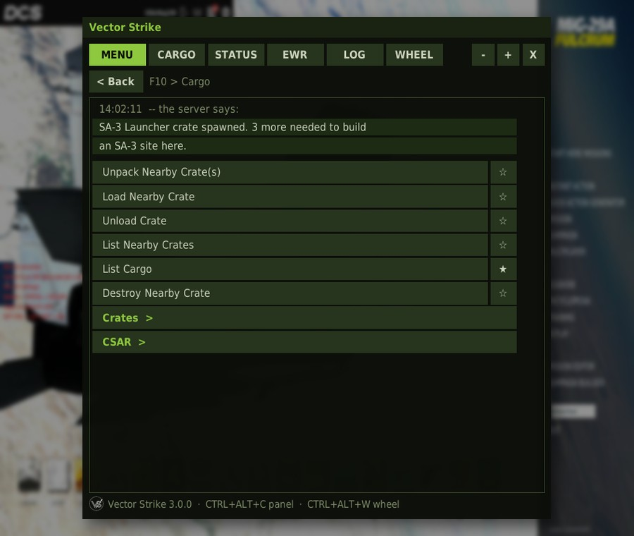
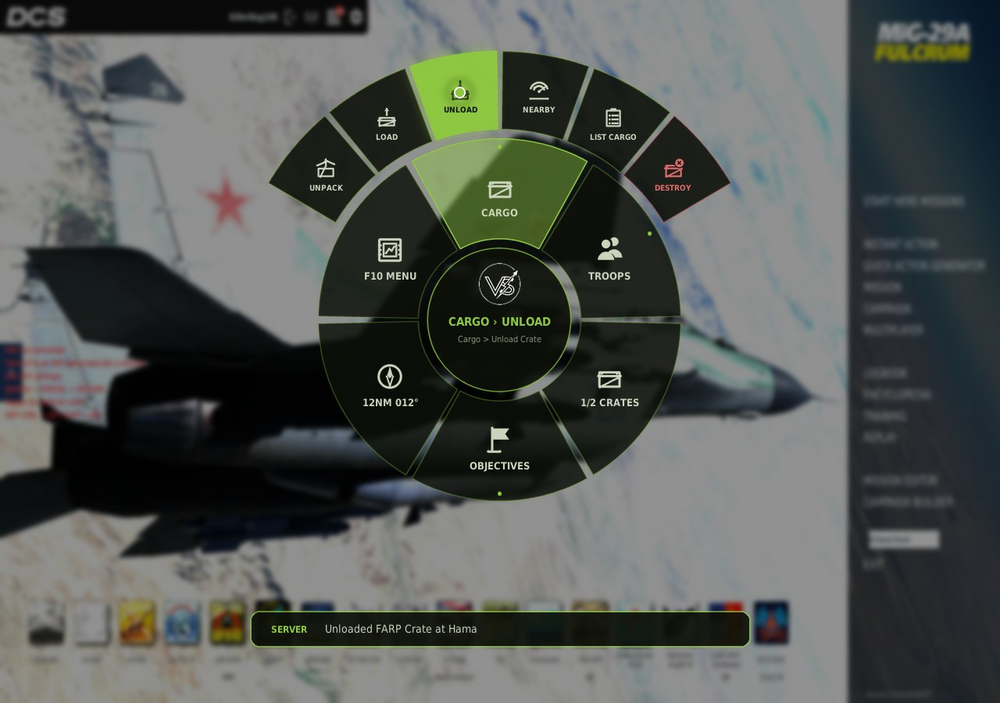

# Vector Strike Cockpit Plugin

An in-game panel for the Fowl Engine campaign — the F10 radio menu as
something you click instead of something you dig through, plus your status and
the EWR picture. Drawn with DCS's own GUI widgets, so it looks and behaves like
the briefing and ESC menus. Works in VR.

This is a **client-side DCS plugin**. You install it; the server doesn't, and
can't — DCS's mission-scripting state lives on the server and has no route to
a connecting player's screen. A script in your own `Scripts\Hooks` folder does.




## Download

From the [GitHub releases](https://github.com/Dillen198/bfnext/releases?q=cockpit-v&expanded=true),
tagged `cockpit-v<version>`:

- **`VectorStrike-Cockpit-Install.exe`** — the installer. This is what players want.
- **`VectorStrike-Cockpit-<version>.zip`** — the same files, for installing by
  hand or with a mod manager (below).

A server's bfdb always links the installer for the version it ships at
`/api/cockpit/plugin/installer`. The installer isn't code-signed, so Windows
may say it's from an unknown publisher: **More info → Run anyway**.

## Install

Run **`VectorStrike-Cockpit-Install.exe`**, press **Install**, restart DCS. That's it.
Close DCS first: the installer replaces a DLL that DCS holds open.

A window opens listing every DCS profile it found on your machine — `DCS`,
`DCS.openbeta`, a server profile, anything else named `DCS*`. They all start
ticked, because having more than one profile and installing into only one of
them is the usual reason the plugin "doesn't work". Untick any you don't want.

It looks for your Saved Games folder where Windows actually says it is, so a
Saved Games moved onto another drive or into OneDrive is still found. If yours
is somewhere it can't guess — you launch DCS with `--write-dir`, say — use
**Add profile...** and point at the folder with `Config` and `Logs` in it.

**Uninstall** is the button next to it. Your settings are left in place, so
reinstalling keeps your window position, opacity and key.

Everything is embedded in the exe: nothing to unzip, nothing to keep next to
it, no runtime to install, and no DCS game file touched.

### Updates

From 3.2 the plugin updates itself (**Update automatically** on the Special
page, on by default). When the server's bfdb ships a newer version
(`/api/cockpit/plugin/version`), `bfcockpit_net.dll` downloads that version's
installer from its GitHub release (`cockpit-v<version>`; the address is fixed
in the DLL, the server only supplies the version number) into
`%TEMP%\VectorStrikeCockpit\` and starts it hidden with
`--auto-update --write-dir <profile>`. It waits until DCS has let go of the
DLL, i.e. until DCS is closed, installs into that one profile, logs to
`Logs\bfcockpit-update.log` and exits. It never installs an older version
over a newer one.

### Scripted installs

`bfcockpit-install-cli.exe` is the same thing without the window — for rolling
it out across machines, or for seeing exactly where it looked when the window
found nothing.

```
bfcockpit-install-cli.exe --list                        just show what it finds
bfcockpit-install-cli.exe --yes                         don't ask, do all of them
bfcockpit-install-cli.exe --write-dir "D:\DCS profile"   a profile in an odd place
bfcockpit-install-cli.exe --search   "D:\Saved Games"    another place to look
bfcockpit-install-cli.exe --url http://192.168.1.50:8880 your own bfdb
bfcockpit-install-cli.exe --uninstall
```

`--write-dir` wants the folder DCS *writes* to — the one with `Config` and
`Logs` in it — not the folder DCS is installed in.

### Installing by hand, or with a mod manager

Two folders, mirroring a DCS profile:

```
Scripts\Hooks\bfcockpit.lua                      the panel
Mods\Services\BFCockpit\                         its Options -> Special page
Mods\Services\BFCockpit\bin\bfcockpit_net.dll    HTTPS for it
```

All go under `%USERPROFILE%\Saved Games\DCS\`. The script without the DLL
opens, but can only tell you the DLL is missing.

## Using it

| Key | |
| --- | --- |
| your **Comms / radio-menu** key | opens the panel |
| `Ctrl+Alt+C` (change it in Options → Special) | show / hide, from anywhere |
| `Ctrl+Alt+W` (change it in Options → Special) | the wheel (below) |

The panel has six tabs (the sixth, WHEEL, edits the wheel -- see below):

- **MENU** — your whole F10 menu, live from the engine. Click a submenu to go
  in, **< Back** to come out, click a command to run it. Whatever F10 answers
  ("Need 3 crates", "you must land to spawn crates", the cargo list) appears
  in a box at the top of the list, instead of only flashing in the corner of
  the screen. No `More >>` paging: the list scrolls.
- **CARGO** — what you are carrying and how much room is left, the crates
  lying near you (range and bearing), one-click Unpack / Load / Unload, the
  base-supply crates, and every deployable by category with **how many of
  each crate it needs**, what it weighs and what it costs. **SPAWN 1** and
  **SPAWN ALL n** fire the same F10 commands, with the same rules.
- **STATUS** — who you are, your side, points, lives and crates; your aircraft,
  position, altitude, heading and speed; your home base, the base you're
  parked at, and the nearest objective with range and bearing.
- **EWR** — threats, friendlies or ground intel, plus EWR calls on/off and
  imperial/metric.
- **LOG** — every message the server has sent you, newest first, tagged YOU /
  SIDE / ALL. The tab counts what arrived while you were looking elsewhere.

**-** and **+** in the corner change opacity; **X** hides the panel. Drag it
by its title bar and resize it from its edges. Position, size and opacity are
remembered.

## The wheel

A Flow-style radial menu in Vector Strike colours, for doing things without
reading anything.

- **Tap the wheel key** (`Ctrl+Alt+W` unless you change it). The wheel opens
  in the middle of the screen, or where the mouse is if you choose that.
- **Point** with your **head** (TrackIR or VR: a dot shows where you are
  pointing; turning the aircraft does not move it) or with the **mouse**, or
  a VR controller's laser, which DCS treats as the mouse. Whichever moved last
  wins.
- Pointing at a **group** (an F10 menu like Cargo, or a group you made) fans
  its contents out on an **arc** just outside it. Push further out onto the
  arc to pick one: no clicking into submenus. Picking the group itself opens
  it as the whole ring, for long lists.
- **Click**, or **tap the key again**, to fire what is lit up. The **hub** in
  the middle goes back a level, or closes the wheel at the top.
- What the server answers shows in a strip under the wheel. Anything that
  destroys or deletes has to be picked twice.
- **Keys only** (no mouse, no head): while the wheel is open, ← / → step
  round the ring, ↑ moves out onto a group's arc, ↓ comes back, Enter fires,
  Backspace goes back. Numpad (4 6 8 2, 5, 0) and Ctrl+Alt + arrows sets are
  on the Special page. The keys are only taken while the wheel is open; map a
  HOTAS hat to them with your stick's software. While keys drive, small head
  movements are ignored so a VR headset cannot steal the selection.
- **Live info** slots show a value instead of running a command (nearest
  objective with range and bearing, crates aboard, takeoff hold, points, last
  message); picking one opens the panel where it comes from.

**Building your own:** the panel's **WHEEL** tab edits the wheel for the
aircraft type you are in. Add F10 menus, live-info slots, panel shortcuts and
your own groups; reorder with ▲ ▼, change an item's icon, move pinned
commands into a group, rename groups, or reset to the default. The **☆** next
to any command in the MENU tab pins it to the wheel. Until you change it,
each aircraft gets a preset (logistics for helicopters and the C-130, combat
for everything else).

**Options → Special → Vector Strike** sets the wheel key, head pointing, how
far you turn your head to reach the ring (the arc is twice that), look-to-fire
dwell (off by default), size, colour (Vector Strike green, blue, amber, red,
white), opacity, where it opens and which keys drive it.

**VR:** the wheel is drawn larger and always opens where you are looking (DCS
locks its GUI to your head in VR), and head pointing works with the headset
exactly as with TrackIR.

The art (ring segments, arcs, the Vector Strike icon set) is generated by
`bfcockpit/tools/wheelgen.py` and `bfcockpit/tools/vsicons.py`.

A HOTAS button can open it through your stick software's key mapping: DCS
does not let a Hooks script add its own entry to the Controls page.

## Settings

**Options → Special → Vector Strike** sets:

- the show/hide **key**: any letter, digit, F1–F12, numpad digit, Insert,
  Delete, Home, End or Pause, with any of Ctrl / Alt / Shift;
- whether the **Comms key** also opens the panel;
- the **panel size** (Auto is 100% on a monitor, 135% in VR).

Changes apply within a few seconds, even mid-mission.

Everything else is in `%USERPROFILE%\Saved Games\DCS\Config\BFCockpit.lua`,
which the first run writes. Every key is optional:

```lua
cockpit = {
    api      = "https://api.vectorstrike.org",
    instance = nil,     -- pin a server, e.g. "vs1"
    opacity  = 0.95,
    vr       = "auto",  -- "on" / "off" to force
}
```

`toggle_key`, `open_on_radio_menu` and `scale` in that file are used only
until the Special page has been saved once. A settings file from version 1 is
picked up as it is: a custom `url` becomes `api`.

## VR

Detected automatically from your own DCS options. The window centres itself,
opens larger, and everything in it is scaled up, because a headset cursor
lands near a target more often than on it. Turn `scale` up if your headset
wants more.

## Several servers

Nothing to configure. The plugin tells the campaign which server you're on. If
it ever shows the wrong one, pin it with `instance`.

## How the server knows it is you

The first time you open the panel on a server, the plugin makes up a random
key and sends it to the campaign server as a chat line (`-cockpitkey ...`)
from your own DCS. The server swallows that line — nobody sees it, and it is
not logged — and from then on only requests carrying that key act as you.
Your player number alone is not enough, so nobody else can drive your F10
menu. The key is never written to `dcs.log`, and a new one is made every time
you connect.

## If it doesn't work

Everything it does is logged. Open

```
%USERPROFILE%\Saved Games\DCS\Logs\dcs.log
```

and search for `BFCOCKPIT`. You'll see the version that loaded, whether the
DLL loaded, whether VR was detected and which key is bound. Bring those lines
to the Discord.

- **Nothing in the log** — the script isn't in `Scripts\Hooks`. Re-run the
  installer.
- **The panel says `bfcockpit_net.dll is missing`** — re-run the installer
  with DCS closed.
- **The panel says it can't reach the campaign server** — the message names
  the reason (DNS, TLS, refused, timed out). Check the `api` setting.

## What it touches

`<DCS profile>\Scripts\Hooks\bfcockpit.lua`, `<DCS profile>\Mods\Services\BFCockpit\`
and, if you don't already have one, `<DCS profile>\Config\BFCockpit.lua`.
DCS itself stores the Special-page choices in its own `Config\options.lua`. No
DCS install files are modified, nothing is written to the registry, and
nothing is added to startup.

## Do I need to change MissionScripting.lua?

**No.** That file sanitizes the *mission scripting* Lua state, where mission
`.miz` code runs. The plugin runs in the GUI/hooks state, which DCS never
sanitizes — that's why it can draw windows and load its DLL. (Server admins:
your *server* still needs the sanitize block removed for `require("bflib")`;
that is unrelated to this plugin.)

## For developers

```
bfcockpit/
  Scripts/Hooks/bfcockpit.lua   the panel: dxgui widgets, API client, key
  Mods/Services/BFCockpit/      the Options -> Special page (declare_plugin)
  net/                          bfcockpit_net.dll (crate bfcockpit-net)
  installer/                    bfcockpit-install(.exe / -cli.exe)
```

Build the DLL before the installer — Cargo can't build a cdylib as a
dependency, so the installer's `build.rs` embeds whatever is in
`target/release/` (or `$BFCOCKPIT_NET_DLL`). Built without it, the installer
warns at build time and refuses to install.

```
. .\setup-build.ps1
cargo build --release -p bfcockpit-net
cargo build --release -p bfcockpit-installer
```

**Why native widgets.** Version 1 hosted a web page in DCS's embedded Chromium
(`WebViewWidget`). When that browser comes up changed between DCS builds, and a
page that fails there is a blank grey box with no console. Version 2 has no
browser: the panel is `Window` / `Button` / `Static` / `ScrollPane` with skins
copied from DCS's own and recoloured, the same approach
[rkusa/dcs-scratchpad](https://github.com/rkusa/dcs-scratchpad) has shipped for
years.

**Why a DLL.** DCS's Lua has LuaSocket but no TLS, and a blocking request on
the GUI thread freezes the sim. `bfcockpit_net` runs HTTPS on background
threads: `request(method, url, body, timeout)` returns an id at once, and
`poll()` — called once a frame — returns whatever has finished. It never
raises a Lua error: raising one from Rust inside DCS's `lua.dll` corrupts the
heap and kills the process, so failures come back as values.

**Why "hidden" isn't hidden.** A dxgui window that is `setVisible(false)` stops
receiving its hotkeys. So the window is made once and never hidden for real:
hidden is DCS's own near-invisible chat-minimised skin, no cursor, no
children, and a 1x1 size so it can't catch a click meant for a cockpit switch.

**Testing outside DCS.** `D:\DCS World\bin-mt\luae.exe` is a plain interpreter
on DCS's `lua.dll`, so the DLL can be exercised for real with it. The script
can be run under it too, with stand-ins for the dxgui modules and `net`; the
pixels still need a look in DCS.
